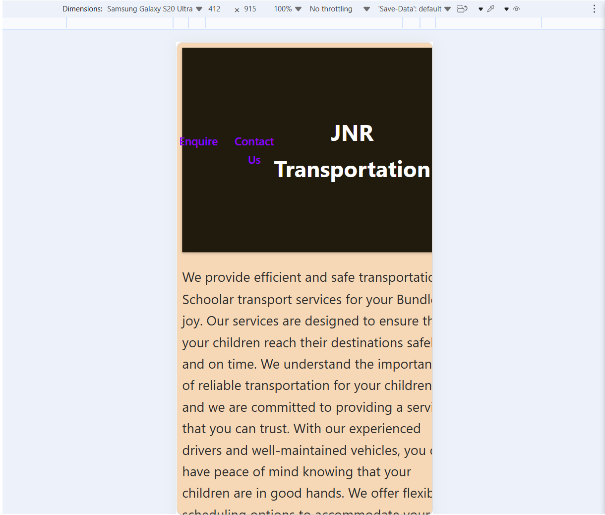
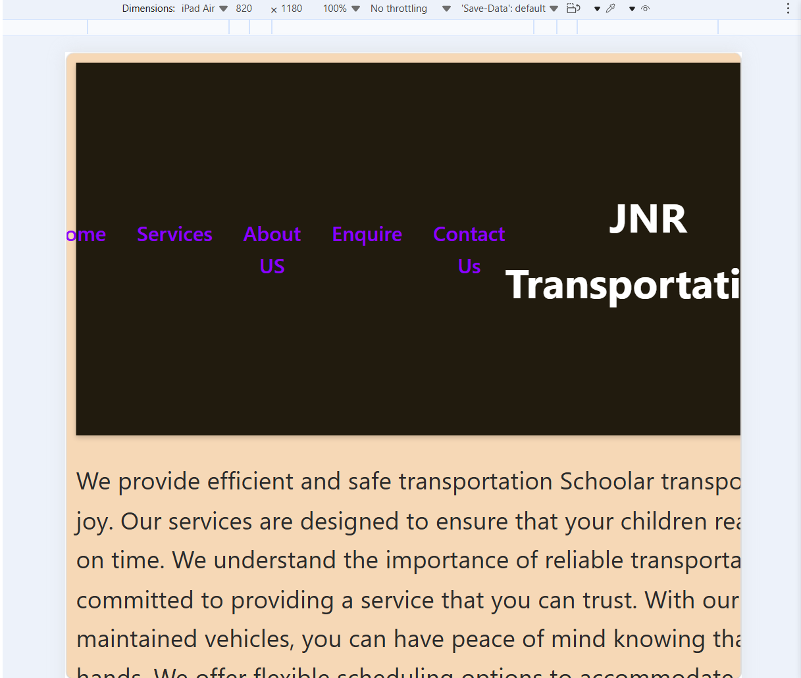
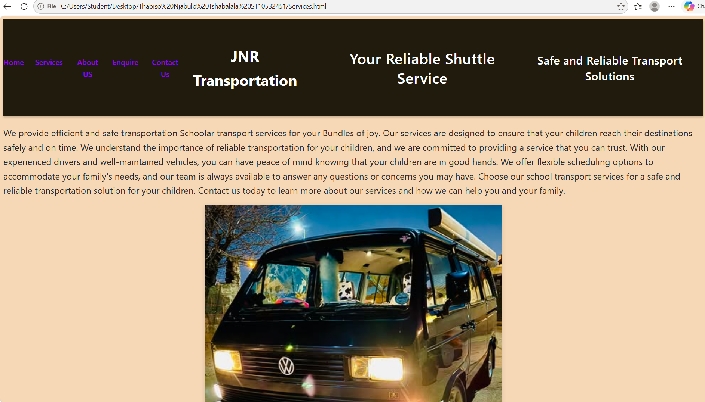

# Thabiso Njabulo Tshabalala ST10532451: JNR-Transportation 
# JNR Transportation

> A responsive website for JNR Transportation, a reliable shuttle service offering local, provincial and around-the-province trips.

| | |
|---|---|
| **Student name** | [Thabiso Tshabalala] |
| **Student number** | [ST10532451] |
| **Module / Year** | [MODULE CODE], 2026 |
| **Live website** | https://njabulotsh56-create.github.io/jnr-transportation/ |
| **GitHub repository** | https://github.com/njabulotsh56-create/jnr-transportation |

---

## Table of contents

1. [About the project](#1-about-the-project)
2. [Pages](#2-pages)
3. [Features (Part 3)](#3-features-part-3)
4. [Form functionality and validation](#4-form-functionality-and-validation)
5. [Search Engine Optimisation (SEO)](#5-search-engine-optimisation-seo)
6. [Performance and security](#6-performance-and-security)
7. [Project structure](#7-project-structure)
8. [Technologies and libraries](#8-technologies-and-libraries)
9. [How to run locally](#9-how-to-run-locally)
10. [Deployment](#10-deployment)
11. [Testing](#11-testing)
12. [Changelog](#12-changelog)
13. [References and acknowledgements](#13-references-and-acknowledgements)

---

## 1. About the project

JNR Transportation is a shuttle service that transports individuals and groups in a VW Kombi. The website lets visitors:

- learn about the business and its services,
- view pictures of the vehicles,
- get an instant estimated quote for a trip,
- contact the business by email, phone or WhatsApp.

**Target audience:** individuals, families, schools, churches and event groups who need affordable, reliable group transport.

**Business contact:**
- Email: juniormatiwane8@gmail.com
- Phone / WhatsApp: 076 392 3556

---

## 2. Pages

| Page | File | Purpose |
|---|---|---|
| Home | `index.html` | Welcome page with the logo, vehicle pictures and a **Book Now** modal |
| About Us | `About.html` | Information about the business (and FAQ accordion) |
| Services | `Services.html` | Trip types offered, with search and filter |
| Enquiry | `enquiry.html` | Validated quote form with AJAX response (cost and availability) |
| Contact | `contact.html` | Validated contact form that builds an email, plus an interactive map |
| Gallery | [GALLERY FILE NAME] | Image gallery with lightbox |

---

## 3. Features (Part 3)

### 3.1 Interactive elements
- **Modal:** the **Book Now** button on `index.html` opens an accessible dialog (`role="dialog"`, `aria-modal`) that links to the enquiry form. File: `Javascript/main.js`.
- **Accordion:** FAQ section built with `<details>`/`<summary>`; JavaScript makes sure only one panel is open at a time. Files: `About.html`, `Javascript/main.js`.
- **Interactive map:** a Leaflet map with OpenStreetMap tiles shows the pickup location with a marker and popup. Files: `contact.html`, `Javascript/map.js`.
- **Gallery with lightbox:** clicking a thumbnail opens the image in a larger overlay. It closes with the × button, by clicking outside the image, or with the Escape key. File: `Javascript/gallery.js`.
- **Animations and transitions (CSS):**
  - `fadeUp`: headings fade and slide up on page load.
  - `slideFromLeft` / `slideFromRight`: pictures slide across the page one after another.
  - `pulse`: the Book Now button pulses gently.
  - `popIn`: the modal and lightbox pop in.
  - Hover zoom on images.
  - A `prefers-reduced-motion` media query switches animations off for users who need that.
- **Advanced DOM manipulation:**
  - Live character counter on the contact message box.
  - Error messages created and cleared dynamically for each field.
  - Quote results built with `createElement` and `append` (no `innerHTML`).
  - Date picker minimum set to today's date automatically.
  - Email preview built and shown dynamically before sending.

### 3.2 Dynamic content
- **Dynamic loading:** services/prices are loaded from `data/items.json` using `fetch()` (AJAX) instead of being hard-coded.
- **Search, filter and sort:** [DESCRIBE what `search.js` does, e.g. "visitors can search services by keyword, filter by category and sort by price"]. File: `Javascript/search.js`.

---

## 4. Form functionality and validation

Both forms use appropriate HTML form elements (`input`, `select`, `textarea`, `button`), HTML5 attributes (`required`, `minlength`, `maxlength`, `min`, `max`, `type="email"`, `type="tel"`, `type="date"`, `type="number"`) and JavaScript validation. The forms use `novalidate` so JavaScript can show custom, friendly error messages beneath each field.

### 4.1 Enquiry form (`enquiry.html`)
**Purpose:** let a visitor enquire about a trip and receive a cost and availability response.

| Field | Validation |
|---|---|
| Full name | Required, 2 to 50 characters |
| Email | Required, valid email format |
| Phone number | Required, valid phone format |
| Trip type | Required, must choose an option |
| Travel date | Required, today or a future date |
| Number of passengers | Required, whole number from 1 to 60 |
| Extra details | Optional, maximum 300 characters |

**AJAX submission:** on submit, the page does not reload. JavaScript calls `fetch('data/items.json')`, finds the selected trip, and calculates `price × passengers`. The result shows a personalised thank-you, the estimated cost, and an availability message (groups of more than 15 are told availability will be confirmed by email within 24 hours). If the request fails, a friendly error message is shown and the error is logged to the console.

### 4.2 Contact form (`contact.html`)
**Purpose:** send a general message to the organisation.

| Field | Validation |
|---|---|
| Full name | Required, 2 to 50 characters |
| Email | Required, valid email format |
| Phone number | Required, valid phone format |
| Type of message | Required (General question, Feedback, Complaint, Partnership) |
| Message | Required, 10 to 500 characters, with live counter |

**How it works:** once validated, the details are compiled into an email preview. The user reviews it and clicks **Send email**, which opens their email app with a `mailto:` link addressed to the recipient set in the code (`RECIPIENT` in `Javascript/forms.js`: juniormatiwane8@gmail.com). The form's `action` attribute also specifies the recipient.

### 4.3 Error handling
- Error messages appear in a `<span class="error">` under the relevant field.
- Errors are cleared when the form is submitted again.
- Network/JSON failures in the AJAX request are caught with `try/catch`.

---

## 5. Search Engine Optimisation (SEO)

### 5.1 On-page SEO

**Keyword research.** Target keywords (placed naturally in titles, headings, descriptions and body text):

| Keyword | Where used |
|---|---|
| shuttle service [YOUR TOWN/AREA] | Home title, headings |
| group transport [YOUR AREA] | Home and Services |
| Kombi hire / VW Kombi shuttle | Home, Gallery |
| affordable shuttle quote | Enquiry |
| airport / school / event transport | Services |
| [ADD MORE] | [WHERE] |

**Title tags and meta descriptions.** Every page has a unique `<title>` (under about 60 characters) and a unique `<meta name="description">` (under about 155 characters).

| Page | Title | Meta description |
|---|---|---|
| index | [PASTE YOUR TITLE] | [PASTE YOUR DESCRIPTION] |
| About | [PASTE] | [PASTE] |
| Services | [PASTE] | [PASTE] |
| enquiry | [PASTE] | [PASTE] |
| contact | [PASTE] | [PASTE] |

**Header tags.** Each page has exactly one `<h1>`, with `<h2>` for sections and `<h3>` for sub-sections, so the content has a clear hierarchy. Outdated `<center>` tags were removed and replaced with CSS.

**Image optimisation.** Images use descriptive, lowercase, hyphenated file names (for example `jnr-vw-kombi-front.png`) and meaningful `alt` text. Images below the fold use `loading="lazy"` and have `width` and `height` set. Images were compressed to reduce file size.

**URL structure.** URLs are clean and descriptive (`/enquiry.html`, `/contact.html`). Folders and files use consistent naming.

**Internal linking.** All pages share the same navigation bar, and pages link to each other (for example the modal links to the enquiry form, and the home page links to Services and Contact).

**Mobile-friendliness.** Every page includes `<meta name="viewport" content="width=device-width, initial-scale=1.0">`. Layouts use flexbox/grid, `max-width: 100%` on images and relative units so the site works on phones, tablets and desktops.

### 5.2 Off-page SEO (plan and actions)
- **Backlinks:** [LIST what you did or plan, e.g. listing the business on Google Business Profile, local directories such as Yellow Pages / Cylex / Hotfrog, and asking schools or event organisers to link to the site].
- **Social media:** the site links to the business's WhatsApp and social media pages [ADD LINKS]. Photos and the website link are shared on [PLATFORMS].
- **Local SEO:** the business name, area and phone number appear consistently on the site; the contact page includes an embedded map; a Google Business Profile is recommended/created for "[BUSINESS NAME], [AREA]" [CONFIRM].

### 5.3 Additional SEO files
- **`robots.txt`** (root folder): allows search engines to crawl the site, blocks `/data/`, and points to the sitemap.
- **`sitemap.xml`** (root folder): lists every page so search engines understand the site structure.

---

## 6. Performance and security

### Page speed
- Images compressed and lazy-loaded.
- CSS and JavaScript are in separate, small files loaded with `defer`.
- No unnecessary libraries (only Leaflet, loaded on the contact page).
- Unused code removed.

### Security
- Hosted over **HTTPS** (GitHub Pages).
- External links use `rel="noopener noreferrer"`.
- User input is written to the page using `textContent` / `createElement`, never `innerHTML`, which prevents cross-site scripting (XSS).
- Input is validated on the client side (HTML5 and JavaScript). *Note: on a production site, validation would also be repeated on the server.*
- No passwords, API keys or private data are stored in the code. The only personal detail is the public business contact email.

---

## 7. Project structure

```
jnr-transportation/
├── index.html
├── About.html
├── Services.html
├── enquiry.html
├── contact.html
├── [gallery page].html
├── README.md
├── robots.txt
├── sitemap.xml
├── css/
│   └── style.css
├── data/
│   └── items.json
├── documents/
├── images/
└── Javascript/
    ├── main.js
    ├── forms.js
    ├── gallery.js
    ├── search.js
    └── map.js
```

---

## 8. Technologies and libraries

- HTML5, CSS3, JavaScript (ES6)
- [Leaflet](https://leafletjs.com/) 1.9.4: interactive maps
- [OpenStreetMap](https://www.openstreetmap.org/) tiles (© OpenStreetMap contributors)
- Visual Studio Code and Live Server (development)
- Git and GitHub Pages (version control and hosting)

---

## 9. How to run locally

1. Clone or download the repository.
2. Open the folder in VS Code.
3. Right-click `index.html` and choose **Open with Live Server** (the quote form needs a local server because it uses `fetch()`).
4. Visit `http://127.0.0.1:5500/` (or whichever port Live Server shows).

---

## 10. Deployment

The site is hosted on **GitHub Pages**.

1. Created a public repository `jnr-transportation` on GitHub.
2. Uploaded the project files so `index.html` is in the repository root.
3. In **Settings → Pages**, set **Source** to *Deploy from a branch*, branch **main**, folder **/ (root)**.
4. GitHub published the site at https://njabulotsh56-create.github.io/jnr-transportation/.
5. Updated `robots.txt` and `sitemap.xml` with the live URL.

---

## 11. Testing

| # | Test | Expected result | Result |
|---|---|---|---|
| 1 | Submit enquiry form empty | Error message under each required field | [PASS/FAIL] |
| 2 | Enquiry with a past date | "Please choose today or a future date." | [PASS/FAIL] |
| 3 | Enquiry with 0 or 61 passengers | "Enter between 1 and 60 passengers." | [PASS/FAIL] |
| 4 | Valid enquiry (10 passengers) | Thank-you message, cost, availability | [PASS/FAIL] |
| 5 | Valid enquiry (more than 15 passengers) | Large-group message | [PASS/FAIL] |
| 6 | Contact form with short message | "Your message must be at least 10 characters." | [PASS/FAIL] |
| 7 | Valid contact form | Email preview appears; Send opens email app | [PASS/FAIL] |
| 8 | Book Now button | Modal opens and closes | [PASS/FAIL] |
| 9 | Gallery click | Lightbox opens; Escape closes it | [PASS/FAIL] |
| 10 | Map | Map loads with marker | [PASS/FAIL] |
| 11 | Resize to mobile width | No sideways scrolling, layout adapts | [PASS/FAIL] |
| 12 | Browser console | No red errors on any page | [PASS/FAIL] |
| 13 | Live site on GitHub Pages | All pages, images, CSS and JS load | [PASS/FAIL] |

Browsers tested: [Edge / Chrome / Firefox / mobile].

---

## 12. Changelog

### 12.1 Part 2 feedback corrections

> Add one row for **every** correction made from your Part 2 marks and feedback. Describe each edit clearly so the lecturer can see exactly what changed.

| Date | File(s) | Feedback received | Change made |
|---|---|---|---|
| [DD/MM/2026] | [FILE] | [QUOTE THE FEEDBACK] | [WHAT YOU CHANGED AND WHY] |
| [DD/MM/2026] | [FILE] | [FEEDBACK] | [CHANGE] |

### 12.2 Part 3 changes

| Date | File(s) | Change | Reason |
|---|---|---|---|
| 02/11/2026 | `data/items.json` | Removed duplicate arrays; file now contains one valid JSON array with `id`, `name`, `category`, `price`, `description` | The quote form showed "could not calculate your quote" because the file was invalid JSON |
| 02/11/2026 | `Javascript/forms.js` | Added enquiry form validation, AJAX `fetch` quote, error handling; wrapped each form's code in an `if` so scripts do not break on other pages | Part 3: JavaScript validation and AJAX |
| 02/11/2026 | `contact.html` | Moved the form out of `<header>` into `<main>`; set the form `action` to the recipient email | Layout was broken; brief requires `action` attribute |
| 02/11/2026 | `enquiry.html` | Added `id`s and error `<span>`s for each field; set `action` | Validation and error display |
| 02/11/2026 | `index.html` | Corrected `<hearder>` to `<header>`; moved stylesheet link into `<head>`; fixed swapped About/Services nav labels; fixed unclosed link tag | HTML errors and navigation bugs |
| 02/11/2026 | `css/style.css` | Added animations (`fadeUp`, `pulse`, `popIn`, `slideFromLeft`, `slideFromRight`), hover transitions and `prefers-reduced-motion` support | Part 3: animations and transitions |
`Javascript/map.js`, `contact.html` | Added Leaflet map with marker and popup | Part 3: interactive map |
 `About.html`, `Javascript/main.js` | Added FAQ accordion | Part 3: accordion |
 `Javascript/gallery.js`, gallery page, `css/style.css` | Added lightbox | Part 3: gallery with lightbox |
 `Javascript/search.js`, `Services.html` | Added search/filter/sort using `items.json` | Part 3: dynamic content |
 all pages | Added unique titles and meta descriptions | SEO |
 all pages | One `<h1>` per page; removed `<center>` tags | SEO and valid HTML |
|`images/` and all pages | Renamed images (lowercase, hyphens) and wrote descriptive alt text; added `loading="lazy"` | SEO and page speed |
`robots.txt`, `sitemap.xml` | Created both files in the root | SEO |
external links | Added `rel="noopener noreferrer"` | Security |
repository | Renamed `CSS` folder to `css` to match links | GitHub Pages is case-sensitive |
| repository | Deployed on GitHub Pages | Part 3: deployment |

---

## 13. References and acknowledgements

- Leaflet documentation: https://leafletjs.com/
- OpenStreetMap: https://www.openstreetmap.org/copyright
- MDN Web Docs (HTML, CSS, JavaScript, Fetch API, `<details>`): https://developer.mozilla.org/
- Google Search Central (SEO starter guide, robots.txt, sitemaps): https://developers.google.com/search
- GitHub Pages documentation: https://docs.github.com/pages
- Images: photographs of the business's own vehicles, taken by the owner.
- **AI use declaration:** [IF YOUR INSTITUTION REQUIRES IT, state honestly how you used AI, e.g. "Claude (Anthropic) was used to help debug JSON and JavaScript errors and to suggest CSS animations. I tested, understood and adapted all code."]


Date	Activity	Key output or milestone
3 August 2026	Review the project brief and identify the required sections.	Confirmed project scope and requirements
4 August 2026	Research shuttle transportation operations and relevant KPI categories.	Initial list of operational, financial, safety, fleet, and customer-service KPIs
5 August 2026	Select the most relevant KPIs for the transportation company.	Final KPI selection and definitions
6 August 2026	Develop KPI formulas, measurement methods, data sources, and proposed targets.	Completed KPI measurement framework
7 August 2026	Organise the project structure and prepare the first draft.	Draft project completed
8 August 2026	Review the draft for accuracy, relevance, and logical flow.	First internal review completed
9 August 2026	Improve the analysis and add tables, examples, and explanations.	Revised project draft
10 August 2026	Check whether the KPIs support business success and strategic objectives.	KPI alignment review completed
11 August 2026	Edit grammar, formatting, headings, numbering, and referencing.	Professionally formatted final draft
12 August 2026	Conduct a final content review and verify calculations and terminology.	Final quality-control review
13 August 2026	Proofread the complete document and prepare the submission file.	Submission-ready project
14 August 2026	Submit the completed project before the required deadline.	Final project submitted

part 2
i used the microsoft developer tool to check different sizes of screen from desktop view, tablet view and smartphone view so although in the desktop it is full and showing the whole screen in the smaller screens some content from the website gets covered up and it looks more untidy and does not show the full pages of the website.

 
